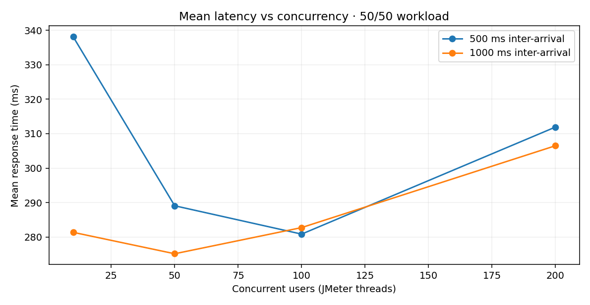

# Web Application Performance Analysis with Apache JMeter

> **Java-backend adjacent project:** Load testing, HTTP workload simulation, Python statistical analysis and experimental design.

A reproducible case study based on an academic performance-testing exercise against the **BlazeDemo demonstration web application**. This repo contains the recorded JMeter results, a readable Jupyter Notebook with executed outputs, and the original test plan.

## At a glance

| | Observed result |
|---|---:|
| Test configurations | **24** |
| HTTP request records | **61,296** |
| Mean response time | **294 ms** |
| 95th percentile (p95) | **428 ms** |
| Recorded HTTP 200 responses | **100%** |

*These are historical measurements from the test run, not benchmark claims for a production system.*

## View the analysis

**[Open the Jupyter Notebook →](notebooks/performance_analysis.ipynb)**  
GitHub renders the notebook's code, tables and charts directly. You **don't need to install anything** to read it.



## Method

- **Target:** a shared public demo flight-booking application (BlazeDemo)
- **Workloads:** browsing flights vs completing the demo purchase flow
- **Concurrency:** 10 / 50 / 100 / 200 JMeter threads
- **Inter-arrival settings:** 500 / 1,000 ms
- **Workload mixtures:** 100/0, 50/50, 0/100 browse/purchase
- **Experiment design:** 24 configurations (4 × 2 × 3), with a 2³ analysis of extreme factor levels
- **Analysis:** latency distribution, p95/p99, factorial effects, confidence/normality exploration and regression on configuration means

## Tools

`Apache JMeter 5.6.3` · `Python` · `pandas` · `NumPy` · `SciPy` · `Matplotlib` · `scikit-learn` · `Jupyter`

## Repository structure

```text
jmeter-web-performance-analysis/
├── README.md
├── notebooks/
│   └── performance_analysis.ipynb    # Start here
├── data/
│   └── results/                     # 24 JMeter CSV files
├── assets/                          # Figures rendered by the notebook
├── jmeter/
│   └── blazedemo_test_plan.jmx      # Original test plan (historical artefact)
├── scripts/
│   ├── analyze_results.py          # Original analysis script, paths adapted
│   └── run_experiments.bat         # Opt-in runner, permission guard
└── requirements.txt
```

## Reproduce the analysis locally

```bash
python -m venv .venv
# Activate the environment as appropriate for your OS
pip install -r requirements.txt
jupyter notebook notebooks/performance_analysis.ipynb
```

Run **Kernel → Restart & Run All**. The notebook reads only the local CSV files and generates the figures from scratch; no network access is necessary.

Alternatively, run the analysis script from the repository root:

```bash
python scripts/analyze_results.py
```

## Interpretation and caveats

- Measurements come from a **shared external demonstration server** with uncontrolled network and background load; no server-side telemetry was available.
- The mean and percentiles describe **observed request times**, not general expected performance under all conditions.
- The regression comparison uses **in-sample configuration means**, so it should not be described as a validated predictor.
- Do not use the included JMeter plan or runner against any host without explicit permission. Public hosting does not imply permission for high-volume testing.

## Author

**Antonis Rouseas** — BSc Informatics & Telematics, Harokopio University of Athens  
[LinkedIn](https://www.linkedin.com/in/antonis-rouseas/) · [GitHub](https://github.com/jerrybananas)
